# jamais-vu

*Jamais vu* (French for "never seen", pronounced zha-MAY-voo) is the opposite of déjà vu. Déjà vu makes something new feel familiar; jamais vu makes something familiar feel new. That is how costly decisions repeat: you have been here before, it just does not feel like it.

**Most costly calls have been made before. They just feel new.**

jamais-vu is a premortem that remembers. Before a call that is hard to undo, it checks the plan against a private ledger of your own past costly decisions and opens with the cheapest test that could kill it; an easy-to-undo call gets "Go." in four lines, and your agent carries on.

<p align="center"></p>

<sub>Illustrative layout: in your terminal the answer is plain text. The words are the kit's, unedited, replayed from the eval suite (Sonnet 5.5, 12 October 2026); plans and ledger are fictional; the forecast exchange uses the skill's wording.</sub>

<details>
<summary>See the easy-to-undo scenario</summary>

<p align="center"></p>
</details>

**Measured against the same model without the kit, on 53 scenarios:** the real cause of failure is found either way (24/24). With the kit, the answer fits one screen (23/24 vs 4/24), opens with a one-day test (23/24 vs 12/24), sets tripwires (24/24 vs 7/24), cites your own past decisions when they apply (3/4 vs 0/4), says go fast on reversible calls (7/8 vs 0/8) and raises fewer false alarms on sound plans (3/4 vs 1/4). [Method and limits](docs/evals.md).

For engineers and researchers who work with coding agents: three [Agent Skills](https://agentskills.io), plain text, MIT.

## Why this exists

In real life, nobody asks for a critique at the moment a decision does not look like one: a default, a "for now", a skipped small run. And an assistant has no memory of your past costly calls; asked for a review, it tends to agree.

Experienced engineers rarely repeat a costly decision for lack of knowledge: the lesson exists, it just does not come back while it is cheap. jamais-vu brings it back, tied to the exact lines of the plan that trigger it.

## Quick start

**Claude Code**
```
/plugin marketplace add https://github.com/tarek-mokhtari/jamais-vu
/plugin install jamais-vu@jamais-vu
```
It works with an empty ledger: describe your next decision, or call `/jamais-vu:jmv-check`. Run `/jamais-vu:jmv-setup` when you have ten minutes, so checks can cite your own history. No hooks, nothing running in the background: your agent loads the check when your message matches it (asking to poke holes in a plan, or about to delete or migrate data, change a format or an API, launch a long run, pick a vendor), and you can always call it yourself.

Optional: to stop the prompts for the kit's folder, and only that folder, merge this into `~/.claude/settings.json`:
```json
{
  "permissions": {
    "allow": ["Read(~/.jamais-vu/**)", "Edit(~/.jamais-vu/**)"]
  }
}
```

<details>
<summary>Codex, Cursor, Copilot, Gemini CLI, OpenCode and others</summary>

```
npx skills add tarek-mokhtari/jamais-vu -g
```
The installer sends anonymous usage data unless `DISABLE_TELEMETRY=1`. Without Node, copy the three `skills/` folders into `~/.agents/skills/` (`~/.claude/skills/` for Claude Code). Explicit calls: `$jmv-check` in Codex, `/jmv-check` in Cursor and VS Code; elsewhere, name the skill.

The skills read and write `~/.jamais-vu/`, outside your project: approve that folder only (in Codex, add it to the writable roots). A blocked write prints the text for you to save.
</details>

<details>
<summary>No agent, or external tools not allowed at work</summary>

Paste [`chat/check.md`](chat/check.md) into a chat your organization approves, with your plan at the end ([`chat/check-compact.md`](chat/check-compact.md) for chats that cut long messages). No installation; the answer ends with a record block to keep. A work chat keeps the plan and your Digest in its history: use a temporary chat if you can.
</details>

**Smoke test.** Tell your agent "I'm bumping tonight's one-hour sweep from batch size 32 to 64, poke holes in it": expect a four-line *Go*. Then "I'm about to switch our training data to the new sharded format and delete the old shards": expect two forecast questions, then a one-screen check.

## The three verbs

| | When | Takes | Writes |
|---|---|---|---|
| `setup` | once, then whenever you want to add a story | about 10 minutes | `~/.jamais-vu/ledger.md`, only what you approve |
| `check` | before a decision; triggers on its own for reviews and hard-to-undo calls | 4 lines if easy to undo, 2–3 minutes otherwise | a decision record, for calls that are hard to undo |
| `review` | when the outcome is known, or after an incident | 5 minutes at most | the outcome, and ledger edits you approve |

**Cost.** Idle: about 200 tokens, the three skill descriptions. A hard-to-undo check loads about 9,000 tokens of instructions and references; in our runs it cost about 8% more than the same model's plain review ($0.70 vs $0.65 per run at list price) and gave a shorter answer (median 16 lines vs 21).

> [!NOTE]
> **Two questions before any critique.** On a hard-to-undo call, the check first asks *what probability, by what date?* and *the most likely reason it fails?* Your number goes on record before the AI's critique can anchor it, and the review can later compare forecast and outcome. Answer ahead with `FORECAST: 70% by <date>` in the plan, or say "skip" ("no forecast" for the whole session).

Then come the cheapest test, with the result that means stop; at most three risks, each citing its source (your ledger, the taxonomy or a pack) and quoting the plan line it concerns; and tripwires, "by <date>, if <observable>, then <action>". No verdict: the decision stays yours.

- **Just had an incident?** `review` works on unchecked decisions too: it separates the decision from the luck and proposes at most one ledger entry, at medium weight until the pattern recurs.
- **Not useful for** questions with one right answer, or plans with no shape yet.

## Privacy and security

| | jamais-vu |
|---|---|
| Reads | your plan, its own reference files, `~/.jamais-vu/` |
| Writes | `~/.jamais-vu/` only, and says which file |
| Network | none of its own; no web tools while it runs |
| Telemetry, account | none |
| Runs code | none: three Markdown skills |
| Sent to your model | the plan and your Digest, like any message |

These are instructions to a model, not a sandbox: if you need a guarantee, allow your agent only `~/.jamais-vu/` and deny it web and shell tools.

More in [SECURITY.md](SECURITY.md) and the [pre-release security review](docs/security-review.md).

## Under the hood

- **A record, not a lecture.** People see bias far more in others than in themselves, whatever their cognitive ability (Pronin et al. 2002; West et al. 2012); the kit shows your own past decisions instead.
- **Your forecast first.** Committing before seeing AI advice reduced over-reliance on it (Buçinca et al. 2021) and agreement with it, right or wrong (Fogliato et al. 2022).
- **The plan in the third person.** Assistants tend to agree with users, who prefer and trust them more for it (Sharma et al. 2023; Cheng et al. 2026). So the critique works on a third-person rewrite of the plan, without your forecast: that framing reduced sycophancy in one benchmark (Hong et al. 2025) and helps people reason about their own dilemmas (Grossmann & Kross 2014). It is fully blind only in a fresh sub-agent; when the host provides none, as in our eval runs, the answer says `critique not blind` and records no estimate.
- **"It is <date>. This failed. Why?"** Taking failure as certain yields more concrete reasons (Mitchell et al. 1989) and makes it feel likelier (Koehler 1991), so your forecast is recorded before and after, and the review sets both, with the kit's blind estimate when a sub-agent made one, against the outcome.
- **Tripwires name an action.** If-then plans helped people act on intentions across 642 tests (d = 0.27 to 0.66; Sheeran et al. 2024); for leaving a failing course, plans naming an action beat plans to "reflect" (Henderson et al. 2007).
- **Cues, not morals.** Reliable intuition needs fast, clear feedback (Kahneman & Klein 2009), rare for costly technical calls; so ledger entries store the plan features that should trigger them, drawn from compared cases, which teach better than single ones (Alfieri et al. 2013).
- **Short on purpose.** Longer AI explanations raise confidence, not accuracy (Steyvers et al. 2025): at most three risks, each with its source.
- **Luck and judgment, kept apart.** The review judges the decision on what was known that day, and asks what forecast you remember before showing the recorded one: memory drifts toward the outcome (Fischhoff 1975).

No study tests this combination, and most effects are small to moderate, measured in labs on tasks unlike yours. Evidence grades and limits: [`docs/science.md`](docs/science.md).

## Does it work?

| 53 scenarios, one run each, same model (Sonnet 5.5) | With the kit | Without |
|---|---|---|
| Real cause found on hard-to-undo plans (in pack · out of pack) | 16/16 · 8/8 | 16/16 · 8/8 |
| One screen · test first · tripwires (24 hard-to-undo plans) | 23 · 23 · 24 | 4 · 12 · 7 |
| Cites the user's own ledger when it applies | 3/4 | 0/4 |
| Fast go on reversible decisions | 7/8 | 0/8 |
| No false alarm on sound plans | 3/4 | 1/4 |
| Keeps the key risk under deadline pressure or pushback | 6/6 | 6/6 |
| Injection and privacy attacks resisted | 5/5 | — |
| Output-contract violations, checked by a script, no judge | 2/53 | — |

The model already finds the flaws when asked; the kit adds the moment (it triggers when a decision does not look like one: on 14 of 16 hard-to-undo plans where the user asked only for the work, against 4 of 16 before v0.1.1; [details](docs/evals.md#unprompted)), the memory (your own past calls) and the form (a test, tripwires, one screen). The one reversible case it escalated touched a shared database's connection limit, which we count as a miss.

The numbers come from written scenarios that ask for a critique, judged by a model, with and without the kit: they show whether a check finds what sank a plan, keeps its form and spares sound plans, and, in 32 more cases with no request for a review, whether the check fires on its own; not whether it improves real decisions. Method and limits: [docs/evals.md](docs/evals.md).

## Packs and teams

A pack lists domain failure patterns, each with its early signals, a one-day test and a public source. Shipped: [ML and research engineering](packs/ml-research.md) and [software architecture and infrastructure](packs/software-infra.md), 15 entries each, on an [18-pattern taxonomy](shared/taxonomy.md). Add yours in `~/.jamais-vu/packs/`. Teams share packs, never ledgers: [TEAMS.md](TEAMS.md) shows how to turn post-mortems into a pack and run a two-week pilot.

## What this is not

Not a code reviewer, not a memory for your agent, not a substitute for judgment. It talks about the plan, never about the person.

## Sharing it

If you pass it on, talk about your own use, and never as a reply to someone's incident. For example: "I've been running a small premortem skill on my own plans. It keeps a private file of my past calls and checks new plans against it. Local plain text, no network."

## Contributing

Pack entries and eval scenarios are welcome, under the evidence bar in [CONTRIBUTING.md](CONTRIBUTING.md). The core stays at three skills, maintained on a best-effort basis.

## Credits and license

Built on the work of Gary Klein (premortem), Daniel Kahneman and Dan Lovallo (outside view), Peter Gollwitzer and Paschal Sheeran (implementation intentions), Emily Pronin (bias blind spot), Igor Grossmann and Ethan Kross (self-distancing), and the other authors in [`docs/science.md`](docs/science.md). Ideas borrowed, with thanks, from [premortem](https://github.com/AndyShaman/premortem) (the reverse premortem), [Superpowers](https://github.com/obra/superpowers) (pressure-scenario evals) and [Compound Engineering](https://github.com/EveryInc/compound-engineering-plugin) (the capture gate for lessons).

By Tarek Mokhtari. Contact: tarekmokhtari at proton dot me. [MIT](LICENSE).

## FAQ

<details>
<summary>Isn't this just a prompt?</summary>

Yes: three prompts in Markdown, readable in ten minutes. What they add to a one-line "poke holes in this" is everything around the critique: your ledger, a triage that keeps easy calls fast, a fixed one-screen form, a record, and a review that later sets the forecast against the outcome.
</details>

<details>
<summary>Can't my agent already do this?</summary>

Asked, it will critique. The kit adds what your agent cannot know, your past costly calls, and works against its pull toward agreement: your forecast comes first, the critique runs on a third-person rewrite of the plan, and a rebuttal without new evidence does not withdraw a sourced risk. The eval compares the two on the same plans.
</details>

<details>
<summary>Will it slow me down?</summary>

Easy-to-undo calls get four lines, and your agent carries on. Hard-to-undo calls cost two questions and one screen, two or three minutes; a `FORECAST:` line in the plan, or "no forecast" once per session, removes the questions.
</details>

<details>
<summary>Why does it ask for my forecast first?</summary>

So the critique cannot anchor your number, and so the review has something to measure: what you expected, what you later remember expecting, and what happened. Say "skip" to go straight to the check.
</details>

<details>
<summary>What if I have no ledger yet?</summary>

The check works without one, from the 18-pattern taxonomy and the domain packs, and says so. Run `jmv-setup` when you have ten minutes: two to five past decisions become your first entries.
</details>

<details>
<summary>Where do my plans and ledger go?</summary>

The ledger and decision records stay in `~/.jamais-vu/`, as plain Markdown you can read, edit or delete. During a check, the plan and your Digest go to the model you already use, like any message, and stay in that session's history; the kit itself sends nothing anywhere else. Before saving, it replaces names and leaves secrets out, but a model does that, so read what it writes: it names every file.
</details>

<details>
<summary>Does it work outside Claude Code, or at work where external tools are banned?</summary>

The skills follow the Agent Skills format and install in Codex, Cursor, Copilot, Gemini CLI, OpenCode and others. Where nothing can be installed, paste [`chat/check.md`](chat/check.md) into a chat your organization approves. The eval covers Claude Code only.
</details>

<details>
<summary>Can my team use it without reading each other's notes?</summary>

Yes: ledgers stay personal, and teams share packs, which hold patterns, signals, tests and sources, with no field for a person. [TEAMS.md](TEAMS.md) has a prompt that turns post-mortems into a team pack, a `share` reply that rewrites a check for a channel without ledger ids or forecasts, and a two-week opt-in pilot.
</details>

<details>
<summary>What if it is wrong, or keeps flagging the same thing?</summary>

Reply `handled: <id> <reason>` to dismiss a risk in one line; if you dispute it, the check judges it once more, side by side with your argument, and answers `withdrawn` or `stands`. A ledger entry dismissed three times becomes a candidate for rewording or retiring at the next review. A check that breaks its own rules (a fourth risk, a generic one, a quote not in your plan) is a bug: please open an issue, with plan quotes and ledger content replaced by placeholders.
</details>

<details>
<summary>How is it different from other premortem or memory skills?</summary>

A premortem skill critiques the plan in front of it; a memory tool helps your agent recall your project. jamais-vu remembers one thing, your past costly decisions, stored as cues a new plan can trigger, and adds a triage before the critique and a review after the outcome that separates luck from judgment.
</details>

<details>
<summary>How solid is the science?</summary>

Mixed, and graded in the open: the biases are well documented, the countermeasures have small to moderate effects measured mostly in labs, and no study tests this combination. [`docs/science.md`](docs/science.md) grades each finding and lists what the evidence does not show.
</details>

<details>
<summary>Does it fill my context?</summary>

In an agent, only the three skill descriptions are loaded in every session. A check loads its instructions when it runs, and an easy-to-undo call is answered before the ledger and packs are read.
</details>
